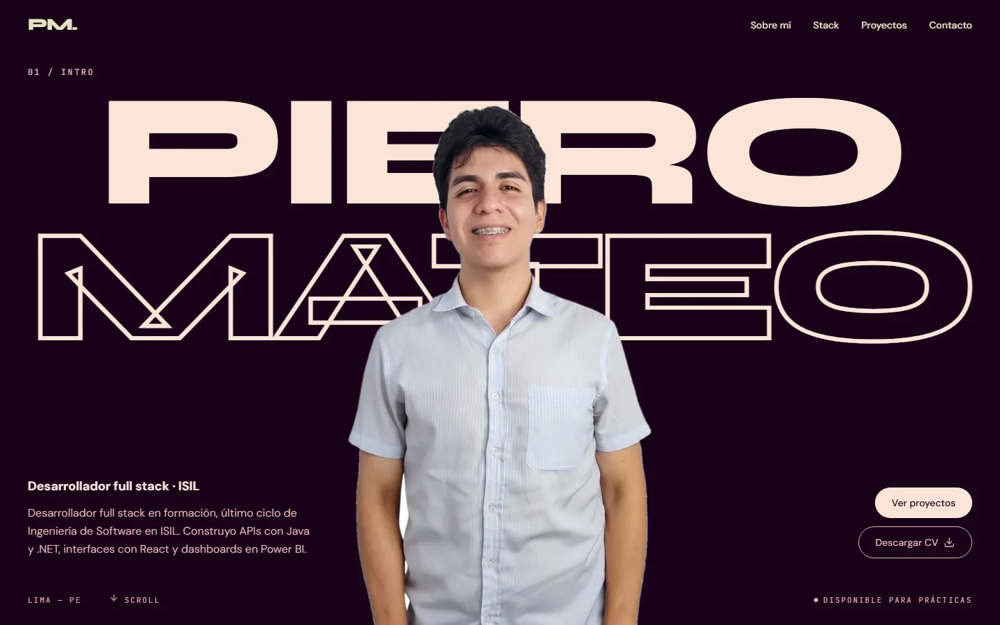

# Portafolio — Piero Mateo Rosado

Portafolio personal de Piero Mateo Rosado, desarrollador full stack en formación (Ingeniería de Software, ISIL). La página presenta mi perfil, las tecnologías que uso y mis proyectos, con un recorrido animado que avanza al hacer scroll.

Está hecho con React, Vite, Tailwind CSS, GSAP y Lenis.

